# Triplan 포트폴리오


## 목차

1. [프로젝트 개요](#1-프로젝트-개요)
2. [팀 소개와 역할 분담](#2-팀-소개와-역할-분담)
3. [기술 스택과 선정 이유](#3-기술-스택과-선정-이유)
4. [시스템 설계](#4-시스템-설계)
5. [주요 기능](#5-주요-기능)
6. [기술적 도전과 문제 해결](#6-기술적-도전과-문제-해결)
7. [품질 관리](#7-품질-관리)
8. [협업 방식](#8-협업-방식)
9. [진행 현황과 향후 계획](#9-진행-현황과-향후-계획)
10. [회고](#10-회고)

---

## 1. 프로젝트 개요

**Triplan**은 여행 일정(방문지 · 이동 수단 · 숙소)을 짜면 경비가 자동으로 합산되고, 완성한 계획을 공유 게시판에 올려 다른 사람과 나눌 수 있는 여행 플래너 웹 서비스입니다.

| 항목 | 내용 |
|------|------|
| 소속 | 영남이공대학교 3학년 일취반 팀 프로젝트 |
| 기간 | 2026-07-15 ~ 진행 중 (첫 커밋 기준) |
| 인원 | 2명 |
| 범위 | 국내 여행 |
| 저장소 | [yncteamproject/Triplan](https://github.com/yncteamproject/Triplan) |
| 배포 | https://triplan-livid-delta.vercel.app (화면 Vercel · 백엔드 AWS EC2) |
| 협업 도구 | [노션](https://app.notion.com/p/671d327294924936916e5f28851598b6) (일정 · 회의록), [Figma](https://www.figma.com/design/ndkdnGp1QYxBRt6Oiz6G2w) (화면 디자인) |

### 기획 배경
> ✏️ **초안입니다. 직접 고쳐 써 주세요.** 작업 기록을 바탕으로 쓴 글이라, 실제 생각과 다르면 지우고 본인의 말로 바꿔야 합니다.

여행을 준비하다 보면 정보가 여러 곳에 흩어집니다. 가고 싶은 곳은 메모 앱에, 위치는 지도 앱에, 비용은 계산기나 표에 따로 적게 됩니다. 일정을 하나 바꾸면 세 군데를 다 고쳐야 하고, 전체 경비가 얼마인지도 다시 더해 봐야 합니다.
Triplan은 이 과정을 한 화면으로 모으려고 만들었습니다. 날짜별로 방문지 · 이동 · 숙소를 적으면 경비가 자동으로 합산되고, 방문지는 지도에 순서대로 표시됩니다. 다 만든 계획은 게시판에 올려서 다른 사람이 그대로 복사해 쓸 수 있습니다.

**쓰기 전에 답해 볼 질문**
- 왜 여러 주제 중에 여행 플래너를 골랐나요? (직접 겪은 불편이 있었나요?)
- 써 본 여행 앱이 있다면 무엇이 불편했나요?
- 이 서비스를 누가 쓰면 좋겠다고 생각했나요?
- "국내 여행"으로 범위를 좁힌 이유는 무엇인가요?

### 핵심 가치
- **경비 자동 합산**: 이동 구간 비용과 숙박비를 합쳐 여행 총 견적을 계산합니다.
- **일정 공유**: 완성한 여행을 게시판에 올리고 댓글로 소통합니다. 예약번호 같은 민감한 정보는 공개하지 않습니다.
- **지도와 대중교통**: 장소를 검색해 넣으면 방문지가 지도에 순서대로 표시되고, 방문지 사이의 대중교통 경로 · 소요시간 · 요금을 볼 수 있습니다.
- **계획 복사**: 다른 사람이 공유한 계획을 내 여행으로 복사해서 날짜만 바꿔 쓸 수 있습니다.
- **성향 테스트**: 여행 성향을 테스트하고 결과를 저장합니다.

---

## 2. 팀 소개와 역할 분담

| 이름 | 담당 |
|------|------|
| [daengsuk2](https://github.com/daengsuk2) (팀장) | 여행 플래너(Trip · Stop · 이동 · 숙소 · 견적), 공유 게시판(게시글 · 댓글 · 공유 여행 상세) |
| [yoonhyoguen](https://github.com/yoonhyoguen) | 회원, 마이페이지, 회원 정보 수정, 여행 성향 테스트 |

- **공동 담당**: 인증 · 인가(로그인, JWT, 권한 검사)와 공통 설정. 공통 이슈는 두 명이 모두 담당자이고, **작업하지 않은 사람이 리뷰**합니다.
- 담당 영역과 패키지(`member` / `trip` / `share` / `traveltest`)를 맞춰 코드 충돌을 줄였습니다.

> ✏️ **초안입니다. 직접 고쳐 써 주세요.** 작업 기록을 바탕으로 쓴 글이라, 실제 생각과 다르면 지우고 본인의 말로 바꿔야 합니다.

| 이름 | 한 줄 소개 | 가장 기여한 부분 |
|------|-----------|-----------------|
| daengsuk2 | (직접 쓰기) | 여행 일정 화면(날짜별 일정 · 지도 · 대중교통 경로)과 공유 게시판 전체(목록 · 상세 · 글쓰기 · 여행 복사), 협업 규칙과 설계 문서 정리 |
| yoonhyoguen | (직접 쓰기) | 회원가입 · 마이페이지 · 여행 성향 테스트 화면, JWT 구조 정리(K7), 예외 처리기 순서 문제 발견과 수정(K10) |

**쓰기 전에 답해 볼 질문**
- 자신을 한 문장으로 소개한다면? (관심 분야, 이 프로젝트에서 맡고 싶었던 역할)
- 가장 오래 붙잡고 있었던 기능은 무엇이고, 왜 오래 걸렸나요?
- 상대방의 작업 중에 "이건 잘했다"고 느낀 것은 무엇인가요?

---

## 3. 기술 스택과 선정 이유

| 구분 | 기술 | 선정 이유 |
|------|------|-----------|
| 백엔드 | Spring Boot 4.0.7, Java 21, Spring Data JPA, Bean Validation | 수업에서 배운 스택을 실제 서비스 규모로 확장 |
| DB | PostgreSQL (Neon, 팀 공용) | 설치 없이 모두 같은 DB를 사용 |
| 인증 | Spring Security + JWT (24시간), BCrypt | React와 백엔드가 분리된 구조라 세션 없는 방식 선택 |
| 프론트엔드 | React 19, Vite 8, axios | 컴포넌트 단위 화면 구성, `client.js`에서 토큰 자동 첨부 |
| 테스트 | JUnit 5, MockMvc, spring-security-test, H2 | 테스트할 때만 각자 컴퓨터의 임시 DB(H2) + `@Transactional` 롤백 (6.7) |
| 협업 | GitHub(Issues · PR · 템플릿 · Actions), Notion, Figma | 코드와 함께 바뀌는 것은 저장소, 일정은 노션. PR마다 CI로 자동 검사 |
| 외부 API | 카카오맵, 오디세이(ODsay) | 지도 · 장소 검색 · 대중교통 경로 (환율은 범위 밖으로 미룸) |
| 배포 | Vercel, AWS EC2(t3.small, 시드니), DuckDNS, Nginx + Certbot | 화면은 merge만 하면 자동 배포. 백엔드는 오디세이가 등록한 IP에서만 동작해서 고정 IP가 되는 EC2, 블루-그린 무중단 배포 (4.5) |

---

## 4. 시스템 설계

### 4.1 아키텍처
```
브라우저
 ├─ 화면  https://triplan-livid-delta.vercel.app  ─ Vercel (React 19 + Vite 빌드 결과)
 │        └─ 카카오맵 JavaScript SDK (지도 · 장소 검색, 브라우저에서 직접 호출)
 └─ API   https://triplan-ync.duckdns.org  ─ AWS EC2 (고정 IP)
          ├─ Nginx: https(Certbot 인증서 자동 갱신), 요청을 백엔드 칸으로 전달
          ├─ 백엔드 두 칸(8081 · 8082)을 번갈아 쓰는 블루-그린 무중단 배포
          └─ Spring Boot (127.0.0.1:8080, 바깥에서 직접 못 들어옴)
               ├─ JPA ──▶ PostgreSQL (Neon)
               └─ 오디세이 대중교통 API (서버에서 호출, 등록한 IP만 허용)
```
각자 컴퓨터에서는 화면(`:5173`)과 API(`:8080`)를 따로 띄우고, 같은 Neon DB를 씁니다. 테스트는 임시 DB(H2)로 돕니다.

### 4.2 패키지 구조: 화면이 아니라 도메인 기준
```
kr.ync.triplan
├─ global/      config(Security, CORS, jwt) · exception
├─ member/      회원 · 인증 · 마이페이지
├─ trip/        Trip + Stop + TransportSegment + Lodging
├─ share/       SharePage + Comment
└─ traveltest/  여행 성향 테스트
```
각 기능 안에서 `controller / domain / dto / exception / repository / service`로 나눕니다. 마이페이지 화면은 `member` · `trip` · `share`의 API를 가져다 쓰는 방식입니다.

### 4.3 ERD
테이블 8개: `member`, `trip`, `stop`, `transport_segment`, `lodging`, `share_page`, `comment`, `travel_preference_result`. 전체 다이어그램은 [ERD 문서](erd.md)를 참고하세요.

핵심 설계 결정
- 작성자 · 주인은 문자열 ID가 아니라 `member_id` **FK**로 저장해 본인 확인(B2 · B3)을 가능하게 했습니다.
- 값 범위(날짜 순서, 0 이상)는 DB 제약이 아니라 서버 검증으로 막습니다.

### 4.4 인증 · 인가 흐름
1. 로그인(`POST /api/auth/login`) → BCrypt로 비밀번호 확인 → JWT 발급
2. 요청마다 `TokenAuthenticationFilter`가 토큰을 검증
3. `SecurityConfig`가 URL별 접근 규칙 적용 (미로그인 401, 권한 없음 403)
4. 작성자 · 주인은 요청 본문이 아니라 **토큰에서** 꺼냄 → 다른 사람 이름으로 글을 쓸 수 없음

### 4.5 배포 구성 ([#85](https://github.com/yncteamproject/Triplan/issues/85))

| 결정 | 이유 |
|------|------|
| 화면은 Vercel | GitHub에 연결해 두면 `main`에 merge될 때마다 자동으로 다시 배포됩니다. 주소에 https가 기본으로 붙습니다 |
| 백엔드는 AWS EC2 + 고정 IP | 오디세이는 **등록한 IP에서만** 동작합니다. IP가 바뀌는 무료 호스팅에서는 대중교통 경로가 동작하지 않습니다 |
| 백엔드에도 도메인(DuckDNS) + https | https 화면에서 http API를 부르면 브라우저가 막습니다. 무료 인증서는 IP가 아니라 도메인에 발급되므로 무료 도메인을 붙였습니다. 처음에는 설정이 가장 짧은 Caddy로 시작했고, 무중단 배포를 넣으면서 Nginx + Certbot으로 바꿨습니다 |
| 비밀 값은 서버의 파일에만 | DB 접속 정보 · JWT 키 · 오디세이 키는 저장소에도 jar에도 넣지 않고, 서버의 jar 옆 파일에서 읽습니다. 배포 서버의 JWT 키는 개발용과 따로 만들었습니다 |
| 서버 전용 설정(`prod` 프로필) | SQL 로그와 H2 콘솔을 끄고, 백엔드는 서버 안(127.0.0.1)에서만 열어 Nginx를 거쳐서만 들어오게 했습니다. 끌 때는 처리 중인 요청을 마치고 끝냅니다(graceful shutdown) |
| CORS 허용 주소는 설정값 | 코드에 고정돼 있던 `localhost:5173`을 설정값으로 옮겨, 배포 주소가 바뀌어도 코드를 고치지 않습니다 |
| 서버 크기 t3.small(메모리 2GB) | 처음엔 비용을 줄이려고 t3.micro(1GB)였지만, 무중단 배포 때 백엔드 두 개(합계 약 1.1GB)가 잠깐 같이 떠야 해서 키웠습니다 |
| 무중단 배포(블루-그린) | 백엔드 자리를 두 칸 두고, 새 버전을 쉬는 칸에 먼저 띄운 뒤 옛 칸을 끕니다. Nginx는 두 칸을 다 알고 있어서 설정을 다시 읽지 않고도 꺼진 칸을 피해 갑니다 (6.15) |
| DB는 개발과 같은 Neon, 서버와 같은 지역(시드니) | 데이터를 한 곳에서 관리합니다. 지역이 다르면 쿼리마다 왕복 시간이 붙어 응답이 수십 배 느려져서 서버와 같은 지역으로 옮겼습니다 (6.14). 개발 데이터가 배포 사이트에 보이고 테이블 변경이 바로 반영되는 점은 문서에 적고 지킵니다 |
| 자동 배포 권한 최소화 | merge되면 GitHub Actions가 백엔드를 배포합니다. 열쇠를 나눠 각각 최소 권한만 줬습니다. AWS 키는 보안 그룹 하나에 SSH 규칙 넣고 빼기만, 서버 열쇠는 `deploy` · `rollback` · `status` 세 명령만 실행되게 묶었고, 백엔드도 sudo 권한 없는 사용자로 바꿨습니다. 하나만 새서는 서버에 들어올 수 없고, 둘이 함께 새도 관리 권한은 없습니다. 원래 계획은 키를 저장하지 않는 OIDC였지만 무료 요금제 계정이라 등록이 막혀 최소 권한 액세스 키로 바꿨습니다 |

**다시 올리는 방법**: 화면 · 백엔드 모두 merge만 하면 됩니다. 백엔드는 GitHub Actions가(급할 때는 `scripts/deploy-backend.ps1` 한 번으로) "최신 `main` 확인 → jar 빌드 → 서버로 전송 → 쉬는 칸에 새 버전 실행 → 켜졌는지 확인 → 옛 칸 종료"까지 하고, 새 버전이 켜지지 않으면 **바꾸지 않고 옛 버전이 계속 서비스**합니다. 바로 전 버전으로 되돌리기도 같은 방식이라 끊김이 없습니다. 방법은 [배포 가이드](deploy.md)에 단계별로 정리했습니다.

---

## 5. 주요 기능

기능 ID와 인수 기준은 [요구사항 명세](requirements.md), 요청 · 응답은 [API 명세](api.md)를 참고하세요.

| 영역 | 기능 | 상태 |
|------|------|------|
| 회원 (M) | 회원가입, 로그인(JWT), 내 정보 조회 · 수정 | ✅ |
| 여행 계획 (T) | 여행 CRUD, 방문지와 순서 · 위치, 이동 구간, 숙소, **자동 견적 합산**, **장소 검색 · 지도**, **대중교통 경로 조회** | ✅ |
| 공유 게시판 (S) | 게시글 CRUD(조회수) · 목록 페이징 · 여행 요약 · **경로 그림**, 댓글, **공유된 여행 상세 보기**, **여행 복사(복사 허용 설정)** | ✅ |
| 성향 테스트 (P) | 제출 · 결과 계산, 최근 결과 조회 | ✅ |

### 5.1 자동 견적 (T5)
이동 구간 비용의 합과 숙소 비용의 합을 더해 총 경비를 반환합니다. 비용이 비어 있거나 데이터가 없으면 0원으로 계산합니다. (예: 교통비 20,000원 + 숙박비 100,000원 → 120,000원)

### 5.2 공유된 여행 상세 (S4)
공유 게시글에 연결된 여행의 방문지(순서대로) · 이동 · 숙소 · 경비 합계를 보여줍니다.
- 로그인 없이 볼 수 있습니다. 조회수는 오르지 않습니다.
- 전용 응답(`SharedTripResponse`)으로 **예약번호를 제외**합니다 (규칙 B12).
- 여행 상세와 **같은 화면 부품**(일정 · 지도)을 보기 전용으로 다시 씁니다. 지도는 응답에 이미 있는 좌표로 그려서 서버를 고치지 않았습니다.

### 5.3 공유된 여행 복사 (S5)
마음에 드는 공유 여행을 내 여행으로 가져와 수정해 쓸 수 있습니다.
- 여행 · 방문지 · 이동 구간 · 숙소를 통째로 복사하고, 이동 구간은 **복사된 방문지에 다시 연결**합니다.
- 시작일을 지정하면 모든 날짜가 같은 간격으로 이동합니다. 예약번호는 가져오지 않습니다 (B12).
- 작성자가 **복사 허용 여부**를 정할 수 있고(B11), 게시글에 복사된 횟수를 보여줍니다.

### 5.4 대중교통 경로 (T7, 외부 API 연동)
두 방문지 사이의 대중교통 경로 후보(소요시간 · 요금 · 환승 · 구간)를 오디세이(ODsay) API로 조회합니다.
- 키가 브라우저에 드러나지 않도록 **서버에서 호출**하고, 프론트는 우리 API만 부릅니다.
- 무료 호출이 하루 30건이라 **같은 경로의 결과는 서버 메모리에 저장해 재사용**합니다.
- 실제 응답을 먼저 확인한 뒤 설계했습니다. 오디세이는 실패도 HTTP 200으로 보내고 오류 모양이 두 가지(객체 · 배열)라서, 경로 없음(빈 목록)과 호출 실패(502)를 구분해 처리합니다.
- 테스트에서는 오디세이를 가짜 응답으로 바꿔서, 호출 횟수를 쓰지 않고 성공 · 경로 없음 · 실패 · 캐시를 확인합니다.

### 5.5 비즈니스 규칙
접근 권한과 값 검증(B1~B12)은 화면이 아니라 서버에서 검사합니다. 화면에서 버튼을 숨겨도 API를 직접 호출하면 서버가 막습니다. 전체 목록은 [비즈니스 규칙](requirements.md#비즈니스-규칙)에 있습니다.

### 5.6 장소 검색과 지도 (T6, 외부 API 연동)
방문지를 추가할 때 장소를 검색해서 고르면 이름 · 주소 · 위치가 한 번에 채워지고, 그날의 방문지가 지도에 번호와 선으로 표시됩니다.
- 카카오맵은 **브라우저에서 직접** 부릅니다. 화면에 넣는 키라서 공개돼도 되지만, 등록한 주소에서만 동작하도록 막혀 있습니다. 서버에서 부르는 오디세이(5.4)와 방식이 다릅니다.
- 지도 SDK는 처음 필요할 때 **한 번만** 불러옵니다. 장소 검색과 지도가 같은 코드를 씁니다.
- 위치가 없는 방문지는 일정에는 보이고 지도에서는 빠집니다. 지도 마커의 번호와 일정의 번호를 맞춰서 어느 마커가 어느 방문지인지 알 수 있게 했습니다.

### 5.7 게시판 카드의 경로 그림 (S7)
게시판 카드의 썸네일은 사진이 아니라, 그 여행의 방문지를 순서대로 이은 그림입니다.
- 카드마다 지도를 띄우면 한 화면에 지도가 9개가 되어 무겁습니다. 그래서 목록 응답에 방문지 좌표를 같이 내려주고(S7), 화면에서 **좌표만으로 선과 점을 그립니다**.
- 동쪽에 있는 곳은 오른쪽, 북쪽에 있는 곳은 위쪽에 찍힙니다. 모든 점이 그림 안에 들어오도록 크기를 맞춥니다.
- 글이 늘어도 조회 쿼리 수가 늘지 않게, 한 페이지의 여행 id를 모아 한 번에 조회합니다 (테스트로 쿼리 수를 확인).
- 좌표가 없는 여행은 "3박 4일 / 10월" 같은 기간 썸네일을 씁니다.

### 5.8 화면
캡처는 예시 데이터로 찍었습니다.

**메인**: 소개와 기능 4가지, 최근 공유된 여행 3개. 기능 칸을 누르면 그 칸이 커지면서 설명이 나옵니다.

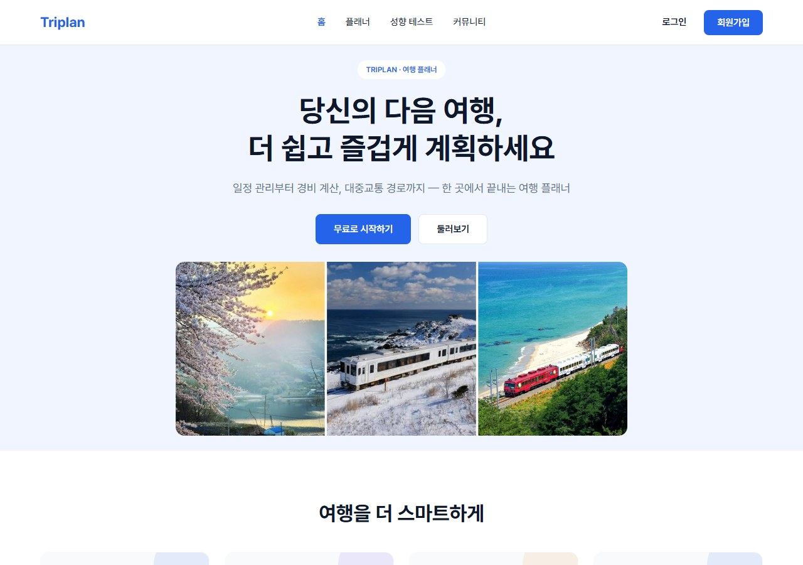
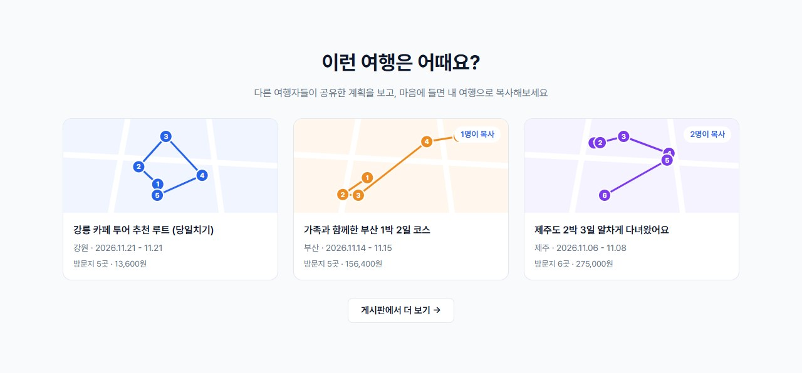

**여행 상세**: 요약 카드(총 일정 · 경비 · 교통비 · 숙박비), 그날 숙소, 날짜별 일정, 지도. 오른쪽 패널에서 방문지 · 이동 구간 · 숙소를 추가하고 고칩니다.

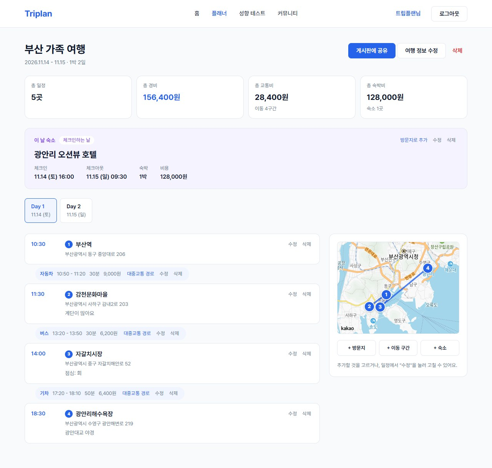

**장소 검색**: 검색해서 고르면 이름 · 주소 · 위치가 채워집니다.

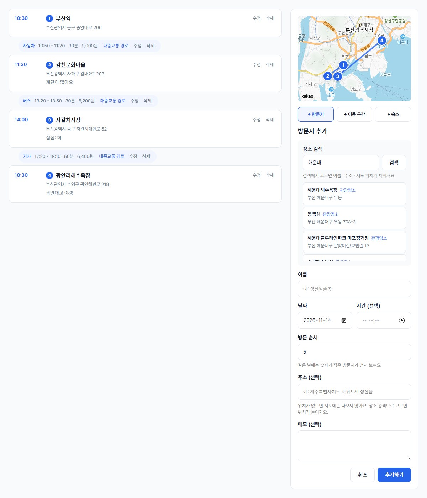

**대중교통 경로**: 이동 구간의 "대중교통 경로"를 누르면 후보 3개를 보여줍니다. 누를 때만 조회합니다.

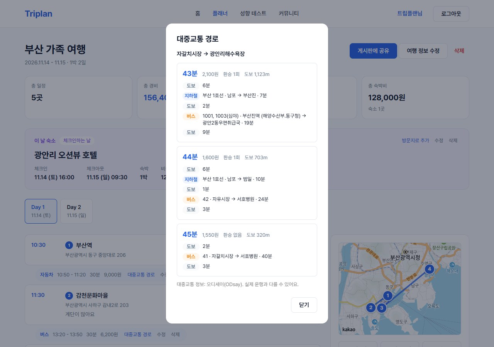

**게시판 목록**: 카드에 경로 그림 · 지역 · 기간 · 방문지 수 · 총 경비 · 복사 수가 보입니다.

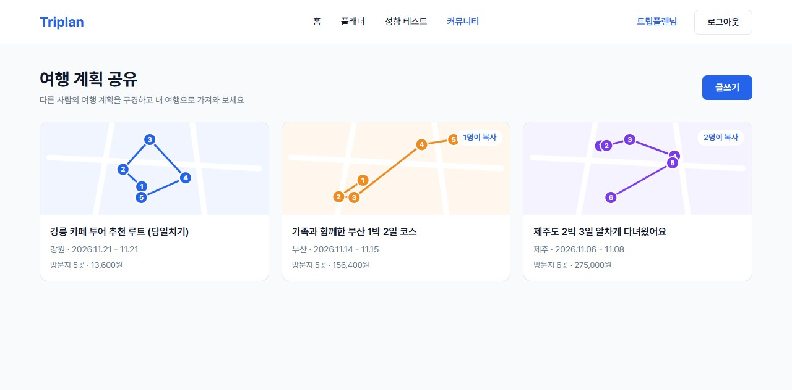

**게시글 상세**: 글, 공유된 여행(보기 전용, 예약번호 제외)과 그날 동선 지도, "내 여행으로 복사", 댓글.

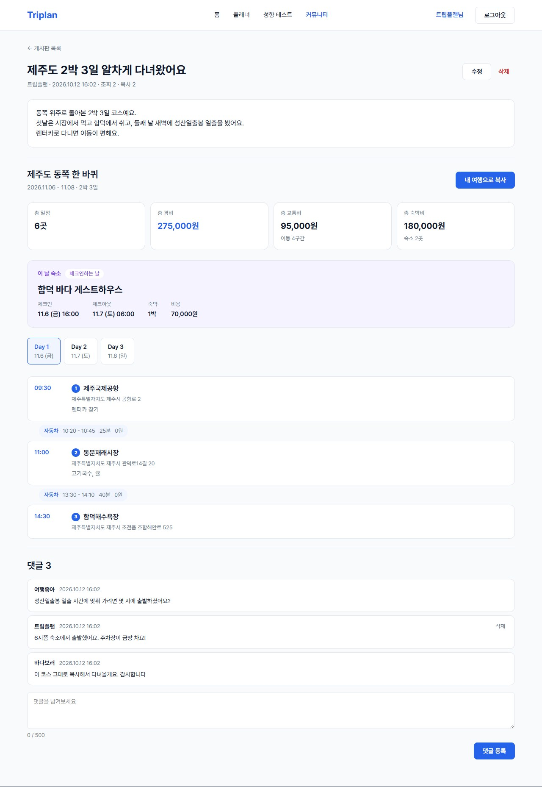

**글쓰기**: 내 여행 중 하나를 골라 공유합니다. 복사를 허용할지 정할 수 있습니다.

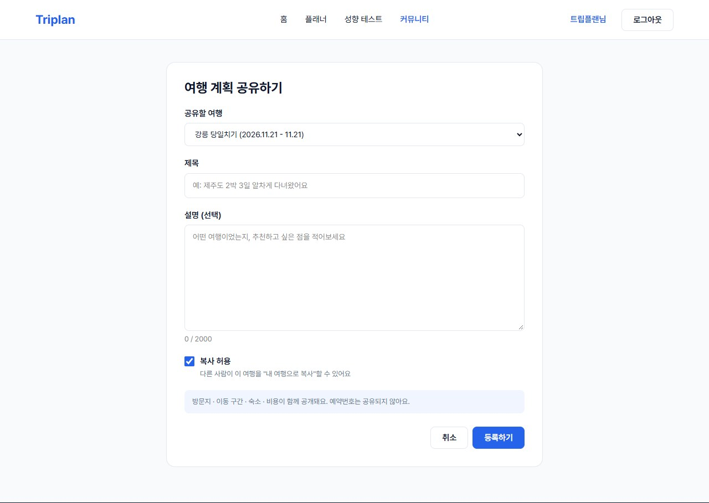

**여행 성향 테스트**: 질문 10개에 답하면 네 가지 성향 중 하나가 나옵니다.

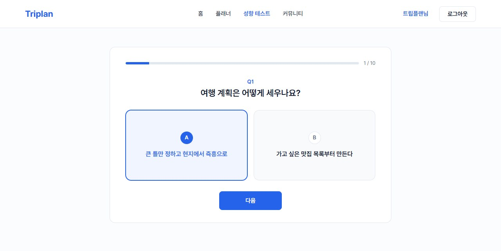
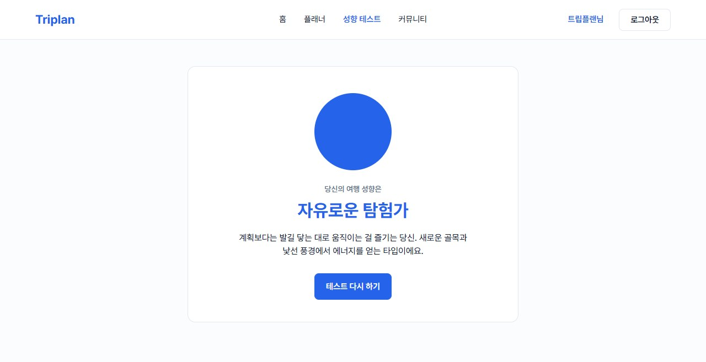

**내 여행 목록 · 마이페이지**

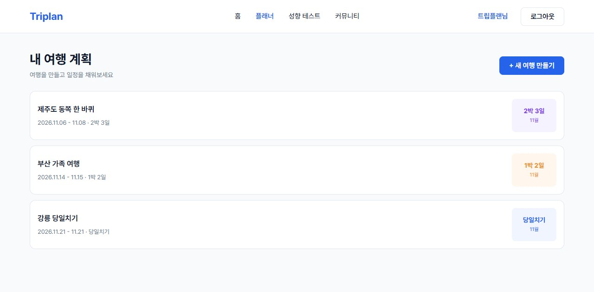
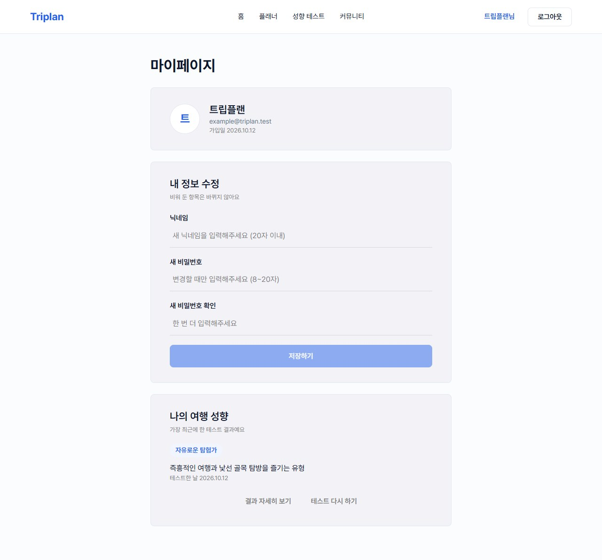

---

## 6. 기술적 도전과 문제 해결

> 형식: 문제 → 원인 → 해결 → 배운 점

### 6.1 하위 데이터가 있는 삭제가 500 에러 (K1, [#7](https://github.com/yncteamproject/Triplan/issues/7))
- **문제**: 방문지 · 이동 · 숙소가 있는 여행이나, 댓글이 달린 게시글을 삭제하면 외래키 제약으로 500 에러
- **원인**: 부모를 지울 때 하위 데이터가 남아 있어 DB가 거부
- **해결**: 공용 DB의 외래키 설정을 바꾸지 않고, 서비스 코드에서 하위 데이터부터 순서대로 삭제 (`TripServiceImpl.delete`: 댓글 → 게시글 → 이동 → 숙소 → 방문지). 하위 데이터가 있는 삭제 테스트 추가
- **배운 점**: 삭제 순서가 코드에 드러나 추적하기 쉽지만, 새 테이블이 생기면 삭제 순서도 같이 고쳐야 합니다. 그래서 [ERD 삭제 규칙](erd.md#삭제-규칙)에 명시했습니다.

### 6.2 브랜치 구조 불일치로 인한 PR 병합 충돌 ([#2](https://github.com/yncteamproject/Triplan/issues/2))
- **문제**: `feature/mainPage → main` PR에서 `.idea/*.xml` 충돌
- **원인**: `main`은 `triplan/`, 기능 브랜치는 `backend/` 구조로 따로 시작했고, 개발자 로컬 설정인 `.idea/`가 git에 추적되고 있었음
- **해결**: `.idea/`를 추적에서 제외하고 `.gitignore`에 등록, 구조를 `backend/` + `frontend/` 모노레포로 통일
- **배운 점**: 프로젝트 시작 전에 구조와 `.gitignore`부터 합의해야 합니다.

### 6.3 Repository 중복 통합 (K4, [#10](https://github.com/yncteamproject/Triplan/issues/10), PR #18)
- **문제**: `MyPageMemberRepository`와 `MemberRepository`가 같은 `Member`를 다룸
- **해결**: `Member`에 `changeNickname` · `changePassword` 전용 메서드를 추가하고 Repository를 하나로 통합. `@Setter` 대신 전용 메서드를 둬서 비밀번호 · 권한 · 이메일이 아무 곳에서나 바뀌지 않게 함
- **배운 점**: 변경 감지(`@Transactional`)로 저장되는 흐름과 "값이 없으면 기존 값 유지" 분기를 리뷰에서 함께 확인했습니다.

### 6.4 Windows 패키지명 대소문자 빌드 오류 (K5, [#11](https://github.com/yncteamproject/Triplan/issues/11))
- **문제**: `travelTest` → `traveltest` 변경 후 `wrong name` 에러
- **원인**: Windows는 폴더 이름의 대소문자를 구분하지 않아 이전 빌드 결과물이 남음
- **해결**: `./gradlew clean test`로 이전 빌드를 지우고 실행. README에 안내 추가

### 6.5 보안: 가입 여부와 민감 정보 노출 방지
- 로그인 실패 시 "이메일 없음"과 "비밀번호 틀림"을 같은 메시지로 응답합니다 (B9, 가입된 이메일 노출 방지).
- 공유된 여행 응답에서 예약번호를 제외합니다 (B12).
- `jwt.secret`이 저장소에 공개돼 있던 문제(K6)는 노출된 키를 폐기하고, 새 키를 git에 올라가지 않는 `application-secret.yaml`로 옮겨 해결했습니다 ([#19](https://github.com/yncteamproject/Triplan/issues/19)).

### 6.6 잘못된 요청을 보내면 로그아웃되는 문제 (K8, [#55](https://github.com/yncteamproject/Triplan/issues/55))
- **문제**: 여행 상세 화면을 확인하다가 주소를 `/trips/abc`로 바꿨더니 로그인 화면으로 튕겼습니다.
- **원인을 찾은 과정**: 화면 문제인 줄 알았는데, 서버에 직접 요청해 보니 400이 아니라 **401**이 오고 있었습니다. 예외 처리기가 두 종류의 오류만 처리해서, 나머지는 스프링이 기본 오류 주소(`/error`)로 넘겼고, 그 주소가 로그인 필요 대상이라 401로 바뀐 것이었습니다. 프론트는 토큰을 붙인 요청이 401을 받으면 로그인 만료로 보고 로그아웃시킵니다.
- **해결**: 예외 처리기에서 오류를 400 · 404 · 405 · 500으로 나눠 응답하고, `/error`로 넘어가는 요청은 로그인 검사를 하지 않게 했습니다. 500은 자세한 내용을 응답에 넣지 않고 서버 로그에만 남깁니다. 화면에서는 id가 숫자가 아니면 서버에 묻지 않도록 한 번 더 막았습니다.
- **배운 점**: 서버 버그가 "로그아웃"으로 보이면 원인을 찾기 어렵습니다. 상태 코드가 실제 상황과 맞아야 화면도 올바르게 대응할 수 있습니다.

### 6.7 실제 데이터가 생기자 테스트가 깨진 문제 (K9, [#66](https://github.com/yncteamproject/Triplan/issues/66))
- **문제**: 새 기능의 테스트를 돌렸는데, 고치지도 않은 게시판 목록 테스트 10개가 실패했습니다.
- **원인을 찾은 과정**: 실패 메시지에 "3개여야 하는데 7개"처럼 숫자가 4씩 많았고, 목록에 메인 화면용으로 넣어 둔 예시 글 제목이 섞여 있었습니다. 테스트가 팀 공용 DB에 연결돼 있어서, **DB에 있는 실제 글이 테스트에 보인 것**이었습니다. 테스트가 넣은 데이터는 끝나면 되돌려졌지만, 원래 있던 데이터는 그대로 보였습니다.
- **고민한 것**: "다른 글이 있어도 통과하게 테스트를 고치는 방법"도 검토했습니다. 하지만 "3개 이상"처럼 느슨한 확인만 남게 되고, 두 사람이 동시에 돌리면 멈추는 문제와 실제 데이터를 건드릴 위험이 그대로 남아서 선택하지 않았습니다.
- **해결**: 테스트할 때만 각자 컴퓨터의 임시 DB(H2)를 쓰도록 테스트 전용 설정을 추가했습니다. 앱 실행은 그대로 공용 DB를 씁니다. 약 4분 걸리던 테스트가 약 40초로 줄었습니다.
- **배운 점**: 테스트는 실제 데이터와 떨어진 곳에서 돌려야 합니다. 화면이 없을 때는 문제가 없었지만, 실제로 글을 쓰기 시작하자 바로 드러났습니다. 처음부터 분리했어야 했습니다.

### 6.8 예외 처리기 두 개의 순서가 정해져 있지 않은 문제 (K10, [#68](https://github.com/yncteamproject/Triplan/issues/68))
- **문제**: 6.6에서 "그 밖의 모든 오류는 500"을 추가한 뒤, 회원 · 성향 테스트용 예외 처리기와 같은 오류를 두 곳이 같이 처리하게 됐습니다. 어느 쪽이 먼저 처리할지 정해져 있지 않아서, 순서가 바뀌면 400이어야 할 응답이 500으로 나갈 수 있었습니다.
- **해결**: 범위가 좁은 처리기에 우선순위를 붙여 항상 먼저 처리하게 하고, 그 문구로 응답하는지 확인하는 테스트를 추가했습니다.
- **배운 점**: 한 사람이 고친 것이 다른 사람의 코드에 영향을 줬고, 리뷰를 하던 팀원이 찾았습니다. 공통 영역을 고칠 때는 "이 변경으로 기존 동작이 달라지는 곳"을 같이 확인해야 합니다.

### 6.9 여러 PR이 같은 문서 줄을 고쳐서 생긴 충돌
- **문제**: 리뷰를 기다리는 동안 다음 작업을 올리다 보니 PR이 여러 개 쌓였고, 앞의 PR이 머지되자 뒤의 PR이 충돌로 머지할 수 없게 됐습니다.
- **원인**: 코드는 서로 다른 파일이었지만, **README의 화면 주소 표에서 바로 붙어 있는 두 줄**을 각각 고쳤습니다. "문서는 같은 PR에서 고친다"는 규칙 때문에 모든 PR이 같은 문서를 건드립니다.
- **해결**: 최신 `main`을 브랜치에 합치고 두 변경을 모두 살려서 해결했습니다. 그 뒤로는 PR을 올리기 전에 열려 있는 다른 PR과 미리 합쳐 보고, 겹칠 것 같은 문서 줄은 떨어진 위치에 넣었습니다.
- **배운 점**: 2명 팀에서 리뷰어는 한 명뿐이라 PR이 쌓이면 충돌 위험이 커집니다. 서로 겹치는 작업은 앞의 PR이 머지된 뒤에 시작하는 것이 빠릅니다.

### 6.10 창을 좁히면 화면 일부가 사라지는 문제
- **문제**: 메인 화면을 창 절반 크기로 봤더니 기능 소개 네 칸이 통째로 보이지 않았습니다.
- **원인**: 좁은 화면에서 칸을 세로로 쌓도록 넣은 규칙이 문제였습니다. 칸에 준 "남는 공간을 똑같이 나누기" 설정이 가로로 놓일 때는 너비를 나누지만, 세로로 쌓이면 **높이를 0으로** 만들었습니다. 게다가 사이트 전체는 최소 너비 1024px로 만들어져 있어서, 좁은 화면용 규칙 자체가 앞뒤가 맞지 않았습니다.
- **해결**: 그 화면의 좁은 화면용 규칙을 뺐습니다. 창을 좁히면 다른 화면과 같이 가로 스크롤이 생깁니다.
- **배운 점**: 넓은 화면에서만 확인하면 놓치는 문제가 있습니다. 좁은 창 대응은 화면마다 따로 넣지 말고 사이트 전체 기준을 먼저 정해야 합니다. (아직 남은 과제입니다.)

### 6.11 대중교통 조회가 컴퓨터마다 실패하는 문제 → 고정 IP 서버 (K11, [#75](https://github.com/yncteamproject/Triplan/issues/75), [#85](https://github.com/yncteamproject/Triplan/issues/85))
- **문제**: 대중교통 경로가 어떤 날은 되고 어떤 날은 502였습니다. 서버 로그에는 아무것도 남지 않았습니다.
- **원인**: 오디세이는 등록한 IP에서 온 요청만 받습니다. 집 · 학교처럼 인터넷이 바뀌면 컴퓨터의 IP가 바뀌어 인증에 실패(`ApiKeyAuthFailed`)했습니다.
- **해결**: 실패 이유를 서버 로그에 남기도록 고쳐서(K11) 원인을 바로 알 수 있게 했고, 배포 서버는 IP가 바뀌지 않는 EC2 + 고정 IP로 정했습니다.
- **배운 점**: 외부 API는 키뿐 아니라 "어디서 부르는지"도 조건이 될 수 있습니다. 배포 환경을 고를 때 이런 조건부터 확인해야 합니다.

### 6.12 https 화면에서 API를 부를 수 없는 문제 → 백엔드에도 도메인
- **문제**: 화면(Vercel)은 https인데 백엔드는 IP 주소(http)뿐이었습니다. 이대로면 브라우저가 화면의 API 호출을 막습니다(혼합 콘텐츠 차단).
- **원인**: https를 열려면 인증서가 필요하고, 무료 인증서는 IP가 아니라 도메인 이름에 발급됩니다.
- **해결**: 무료 도메인(DuckDNS)을 고정 IP에 연결하고, 서버 앞에 Caddy를 두어 인증서를 자동으로 받고 갱신하게 했습니다(뒤에 무중단 배포를 넣으면서 Nginx + Certbot으로 바꿈, 6.15). Vercel이 API를 대신 넘겨주는 방법도 있었지만, 그러면 Vercel에서 서버까지 비밀번호 · 토큰이 암호화 없이 지나가서 쓰지 않았습니다.
- **배운 점**: 화면과 서버를 다른 곳에 두면 주소 · https · CORS를 함께 맞춰야 합니다. 이번에는 CORS 허용 주소를 설정값으로 바꿔서 코드를 고치지 않고 맞췄습니다.

### 6.13 비밀 값이 배포 파일에 같이 들어가는 문제
- **문제**: 비밀 값 파일(`application-secret.yaml`)이 `src/main/resources`에 있어서, 배포용 jar를 만들면 DB 비밀번호와 키가 jar 안에 같이 들어갔습니다.
- **원인**: 그 폴더의 파일은 모두 jar에 포함됩니다. git에서만 빼 두었던 것이라 jar에는 그대로 들어갔습니다.
- **해결**: jar를 만들 때 그 파일을 빼고, 서버에서는 jar 옆에 따로 둔 파일을 읽도록 했습니다. 실제로 jar를 열어 파일이 없는 것을 확인했고, 서버와 같은 방식(jar + 옆 파일 + `prod` 프로필)으로 내 컴퓨터에서 먼저 띄워 봤습니다.
- **배운 점**: "git에 안 올라간다"와 "배포 파일에 안 들어간다"는 다른 문제입니다. 비밀 값이 어디까지 따라가는지 배포 결과물을 직접 열어 확인해야 합니다.

### 6.14 응답이 2.4초, 1초 6건이 한계였던 문제 → 서버와 DB를 같은 지역으로 (K12, [#94](https://github.com/yncteamproject/Triplan/issues/94))
- **발견**: 무중단 배포를 하기 전에 "배포 중 끊김"을 재려고 1초에 10번씩 요청을 보냈더니, **배포하지 않는 시간에도** 요청의 83~88%가 3초 시간 초과로 실패했습니다. 성공한 요청도 평균 2.5초가 걸렸습니다.
- **원인을 좁혀 간 과정**

  | 확인 | 결과 | 알게 된 것 |
  |------|------|-----------|
  | 요청을 하나씩 천천히 | 2.4초 | 몰려서가 아니라 원래 느림 |
  | 서버 안에서 직접 호출 | 1.6초 | 인터넷 구간이 아니라 서버 안이 느림 |
  | 그때 서버 CPU | 100% 쉬는 중 | 계산이 아니라 무언가를 기다림 |
  | 서버 → DB 왕복 | 0.18초 | 기다리는 대상은 DB |
  | 서버 · DB 위치 | 서버 시드니, DB 싱가포르 | 서로 다른 나라 |

- **원인**: 게시판 목록 API는 글 · 개수 · 여행 요약 · 경로 좌표를 위해 쿼리를 여러 번 차례로 보냅니다(글 수와 상관없이 고정). 쿼리마다 0.18초씩 왕복해서 약 8번 × 0.18초 ≈ 1.6초가 됐습니다. DB 연결 10개를 요청마다 1.6초씩 붙잡으니 1초에 약 6건이 한계였고, 서버 로그에도 연결을 기다리다 실패한 기록(`Could not open JPA EntityManager`)이 남아 있었습니다.
- **대안 비교**: 서버를 싱가포르로 옮기기(고정 IP · 오디세이 · 도메인 · 인증서를 전부 다시 설정) / **DB를 시드니로 옮기기**(새 Neon 프로젝트에 데이터 복사, 접속 정보만 교체) / 쿼리 줄이기(거리 문제는 남음) / 캐시(데이터가 늦게 바뀜). 작업이 가장 적고 근본 원인을 없애는 DB 이전을 골랐습니다.
- **결과** (같은 방법으로 다시 측정)

  | 항목 | 전 | 후 |
  |------|----|----|
  | 서버 → DB 왕복 | 0.18초 | 0.004초 |
  | 목록 API (서버 안) | 1.6초 | 0.04초 |
  | 1초 10건 보냈을 때 | 실패 83~88%, p50 2.5초 | 실패 0건, p50 0.25초 |

- **겪은 일**: 서버 접속 정보를 바꿀 때 Neon 화면의 주소(`postgresql://…`)를 그대로 넣어서 `jdbc:`가 빠졌고, 백엔드가 켜지지 못해 60번 넘게 재시작했습니다. 로그의 `claims to not accept jdbcUrl` 한 줄로 바로 찾았고, 배포 가이드의 문제 해결 표에 넣었습니다.
- **배운 점**: 측정이 이상하게 나오면 측정 대상 말고 **측정 환경부터** 의심해야 합니다. 이번에는 "배포 중 끊김"을 재려다가 더 큰 문제를 찾았습니다. 그리고 클라우드에서 서비스를 고를 때 **지역을 맞추는 것**은 사양보다 먼저 확인할 일입니다.

### 6.15 배포할 때마다 사이트가 24~32초 꺼지는 문제 → 블루-그린 무중단 배포 ([#92](https://github.com/yncteamproject/Triplan/issues/92))
- **문제**: 백엔드가 하나라 새 버전을 올리려면 끄고 켜야 했고, 그동안 사이트가 502를 냈습니다. 측정해 보니 배포마다 **24~32초** 동안 백엔드가 꺼져 있었습니다(502 242~319건). 자동 배포(CD)를 넣으면 merge할 때마다 끊기게 됩니다.
- **해결 방향**: 백엔드 자리를 두 칸(8081 · 8082) 두고, 새 버전을 쉬는 칸에 먼저 띄운 뒤 넘기는 블루-그린 방식. 두 버전이 잠깐 같이 떠야 해서 서버를 1GB → 2GB로 키웠고(두 개 합계 약 1.1GB), 앞단을 Caddy에서 Nginx로 바꿨습니다.
- **세 번 고친 과정** (모두 1초 10건, 3회씩 측정)

  | 시도 | 결과 | 원인 · 다음 조치 |
  |------|------|------------------|
  | ① 전환할 때 Nginx 설정을 바꾸고 다시 읽기(reload) | 배포마다 **2건 실패(0.48%)**, 0.3초. 502는 0건 | 백엔드는 한 번도 꺼지지 않았는데, reload 순간 Nginx가 쉬고 있던 연결(keep-alive)을 닫아서 그 연결로 막 보낸 요청이 실패. 마지막 설정 변경 때도 똑같이 2건이 나와서 원인을 다시 확인함 → reload를 아예 안 하는 방식으로 |
  | ② Nginx에 두 칸을 다 등록하고, 꺼진 칸은 Nginx가 다른 칸으로 넘기게 | **0건 / 3건 / 31건(3.4초)** | 첫 번째가 0건이라 성공인 줄 알았지만 세 번 재서 결함을 찾음. Nginx는 연결이 거부된 칸을 5초 동안 "죽은 칸"으로 기억하는데, 새 칸이 켜지는 동안 계속 그렇게 기억된 상태에서 옛 칸을 끄는 순간 두 칸 다 죽었다고 판단(`no live upstreams`) → 기억하기를 끔(`max_fails=0`) |
  | ③ ② + `max_fails=0` | **0건 / 0건 / 0건** | 매번 연결해 보고 거부되면 즉시 다른 칸으로. 서버 안의 연결 거부는 매우 빨라서 손해가 거의 없음 |

- **실패 대비**: 실행되지 않는 jar를 일부러 배포해 보니 전환하지 않고 옛 버전이 계속 서비스했고(실패 0건), 바로 이어서 되돌리기(rollback)도 무중단이었습니다. 실패한 jar는 치우고 쉬는 칸에는 그 전 버전을 되살려 두도록 고쳤습니다. 실패 원인 로그는 공개 저장소의 자동 배포 기록에도 남을 수 있어서 DB 주소를 가리고 오류 줄만 보여 줍니다.
- **결과**: 배포 중 끊김 **24~32초 → 0초**, 새 버전이 켜지는 17~20초 동안에도 옛 버전이 서비스. Caddy → Nginx 전환 자체도 인증서를 미리 받아 두고 한 줄로 바꿔 끊김 0.4초로 끝냈습니다.
- **배운 점**: 한 번 측정해서 0이 나와도 끝이 아닙니다. 같은 조건으로 여러 번 재야 타이밍에 따라 숨어 있는 문제가 드러납니다. 그리고 "설정을 다시 읽는 것"처럼 안전해 보이는 동작도 연결을 끊을 수 있어서, 실패의 종류(502인지, 연결이 닫힌 건지)를 나눠서 봐야 원인을 찾을 수 있습니다.

---

## 7. 품질 관리

- **테스트 방식**: `@SpringBootTest` + `@Transactional` 롤백. 테스트할 때만 각자 컴퓨터의 임시 DB(H2)를 써서, 공용 DB의 실제 데이터와 서로 영향을 주지 않습니다 (6.7).
- **계층별 테스트**: Controller · Service · Repository
- **입력 검증 4종**: 정상 데이터 / 필수 데이터 누락 / null / 비정상 데이터
- **권한 케이스**: 비로그인(401), 남의 데이터(403)를 함께 검증
- **결과**: 백엔드 테스트 291개 통과 (2026-10-22 기준). 프론트는 PR마다 `npm run lint` · `npm run build`를 통과시키고, 화면은 직접 실행해서 확인합니다.
- **CI (GitHub Actions)**: PR을 올리면 바뀐 쪽만 골라 백엔드 테스트, 프론트 lint · build를 자동으로 돌립니다. 결과는 PR에 표시되고, 실패한 테스트 이름은 요약 화면에 바로 나옵니다. 그 전에는 체크리스트에 각자 체크하는 방식이라 확인을 빠뜨려도 알 수 없었습니다 ([#91](https://github.com/yncteamproject/Triplan/issues/91)).
- **외부 API 테스트**: 오디세이는 가짜 응답으로 바꿔서 테스트합니다 (무료 호출 수를 쓰지 않음). 실제 응답은 연동할 때 직접 호출해서 확인했습니다.
- **쿼리 수 확인**: 목록 조회는 글이 늘어도 쿼리 수가 늘지 않는지 테스트로 확인합니다.
- **에러 응답 통일**: `GlobalExceptionHandler`와 `CustomException`으로 일관된 에러 형식 (`timestamp` · `status` · `message` 형태, [API 명세](api.md#에러-응답-형식))
- **알려진 문제 관리**: K1~K13으로 번호를 붙여 이슈와 연결하고 상태를 추적합니다.

---

## 8. 협업 방식

### 8.1 작업 흐름
```
이슈 → main 최신화 → 브랜치 → 작업 + 테스트 + 문서 → PR (Closes #번호) → 리뷰 → merge → 브랜치 삭제 → 노션 상태 변경
```

| 규칙 | 내용 |
|------|------|
| 이슈 | 모든 작업은 이슈로 시작, 종류 · 영역 라벨과 담당자 지정 |
| 브랜치 | `{종류}/{이슈번호}-{짧은-설명}` (예: `docs/25-portfolio`), 이슈 하나당 하나 |
| `main` 보호 | 직접 push 금지, PR → 리뷰 → merge |
| 리뷰 | 서로 한 번씩, 작업하지 않은 사람이 리뷰 |
| 커밋 메시지 | `제목 (변경한 주요 파일)` + 파일별 설명 |
| 문서 | 코드와 같은 PR에서 함께 수정 |
| 문서 분담 | 코드와 함께 바뀌는 것은 저장소, 일정 · 회의록은 노션 |

### 8.2 설계 문서 우선
기능 ID(M/T/S/P)와 규칙 ID(B1~B12)를 만들고 커밋 · PR · 리뷰에서 같은 ID로 말합니다. 이 덕분에 "무엇을 만들었는가"와 "무엇이 맞는가"를 문서로 확인할 수 있습니다.

### 8.3 리뷰 사례
- PR #16 리뷰: 전체 테스트를 로컬에서 돌려 확인하고, 예약번호 제외(B12)와 비로그인 허용 범위(GET만)를 점검
- PR #18 리뷰: 변경 감지 저장, 비밀번호 암호화 저장, 남은 참조, 최신 `main`과의 충돌 여부를 체크리스트로 확인
- PR #59 리뷰: 리뷰어가 공유 글 10개를 직접 만들어 페이지 넘김 · 새로고침 · 잘못된 페이지 번호까지 표로 확인하고 캡처를 남김
- PR #70: 리뷰를 하던 팀원이 다른 PR(#56)의 변경으로 생긴 문제를 찾아 따로 이슈와 PR로 수정 (6.8)

### 8.4 활동 통계 (2026-10-13 기준)

| 항목 | 수 |
|------|----|
| 커밋 | 131 (merge 제외 84) |
| 이슈 | 36 (닫힘 34, 열림 2) |
| PR | 39 (머지 38, 열림 0, 닫힘 1) |
| 백엔드 테스트 | 272 |
| 알려진 문제 | K1~K13 해결 |

수치는 `git rev-list --count origin/main`, `gh issue list --state all`, `gh pr list --state all`로 셉니다. 모든 작업이 끝나면 한 번 더 갱신합니다.

---

## 9. 진행 현황과 향후 계획

| 구분 | 내용 | 상태 |
|------|------|------|
| 백엔드 핵심 기능 | 회원 · 여행 · 공유 · 성향 테스트 API | ✅ 완료 |
| 프론트엔드 화면 | 메인, 로그인 · 회원가입, 마이페이지, 여행 목록 · 만들기 · 상세, 게시판 목록 · 상세 · 글쓰기, 성향 테스트 | ✅ 완료 |
| T6 지도 시각화 | 카카오맵 마커 + 경로, 장소 검색 | ✅ 완료 |
| T7 대중교통 경로 | 오디세이 연동, 결과 캐시 | ✅ 완료 |
| S7 카드 경로 그림 | 목록 응답의 좌표로 그리는 썸네일 | ✅ 완료 |
| 좁은 화면 대응 | 지금은 최소 너비 1024px (좁히면 가로 스크롤) | ⏳ 예정 |
| 배포 | Vercel(화면) · EC2(백엔드) · DuckDNS(도메인) + Nginx(https), 백엔드 다시 올리기 스크립트 (https://triplan-livid-delta.vercel.app) | ✅ 완료 |
| 무중단 배포 | 블루-그린, 배포 중 끊김 24~32초 → 0초 | ✅ 완료 |
| CI | GitHub Actions로 PR 자동 검사 (백엔드 테스트 · 프론트 lint · build) | ✅ 완료 |
| CD | main merge 시 백엔드 무중단 자동 배포 (GitHub Actions + 최소 권한 AWS 키 + 배포 전용 SSH 키, [#92](https://github.com/yncteamproject/Triplan/issues/92)) | ✅ 완료 |
| T8 환율 | 한국수출입은행 API. 국내 여행 범위라 우선순위 낮음 | ⏳ 미정 |

### 해결할 알려진 문제
K1~K13 모두 해결. 새로 발견되면 K14부터 번호를 붙여 관리

**알려진 한계**: 글 · 댓글 · 가입 시각을 실행 중인 서버의 시계(`LocalDateTime.now()`)로 만듭니다. K13은 배포 서버를 한국 시간으로 맞춰 해결했지만, 서버가 어디 있든 맞게 하려면 시각을 UTC로 저장(`Instant` · DB `timestamptz`)하고 화면에서 한국 시간으로 바꿔 보여줘야 합니다. 배포 전(10/14~10/22)에 배포 사이트에서 만든 일부 데이터는 9시간 이른 시각으로 남아 있을 수 있습니다.

### 배포 운영
- 화면은 `main`에 merge되면 자동 배포, 백엔드는 merge 후 `scripts/deploy-backend.ps1` (실패하면 자동으로 이전 버전)
- 오디세이 무료 호출이 하루 30건이라, 여러 사람이 동시에 쓰면 그날은 대중교통 경로가 막힐 수 있습니다
- 발표 후 더 쓰지 않으면 서버 종료와 고정 IP 반납을 둘 다 해야 요금이 멈춥니다
- 방법은 [배포 가이드](deploy.md)

---

## 10. 회고

> ✏️ **초안입니다. 직접 고쳐 써 주세요.** 작업 기록을 바탕으로 쓴 글이라, 실제 생각과 다르면 지우고 본인의 말로 바꿔야 합니다.

### 잘된 점
- **이슈 → 브랜치 → PR → 리뷰 흐름을 끝까지 지켰습니다.** 모든 작업이 이슈 번호로 이어져 있어서, 나중에 "왜 이렇게 만들었는지"를 PR과 이슈에서 찾을 수 있습니다.
- **기능 ID(M/T/S/P)와 규칙 ID(B1~B12)로 대화했습니다.** "S5의 B11"처럼 말하면 서로 같은 것을 가리켰습니다.
- **문서를 코드와 같은 PR에서 고쳤습니다.** 문서가 코드보다 뒤처지지 않았습니다.
- **리뷰에서 실제 문제가 잡혔습니다.** 직접 실행해서 확인하는 리뷰를 했고, 다른 PR의 부작용(K10)도 리뷰 중에 찾았습니다.
- **외부 API는 실제 응답을 먼저 확인하고 설계했습니다.** 문서와 실제 응답이 다른 부분(실패도 200으로 오는 점)을 미리 알았습니다.

### 아쉬운 점
- **테스트 DB를 늦게 분리했습니다.** 처음부터 임시 DB를 썼다면 실제 데이터 때문에 테스트가 깨지는 일(K9)이 없었을 것입니다.
- **PR이 쌓여서 충돌이 났습니다.** 리뷰를 기다리며 다음 작업을 계속 올리다 보니 같은 문서를 고친 PR끼리 부딪혔습니다.
- **좁은 화면을 고려하지 않았습니다.** 넓은 화면만 보고 만들어서, 창을 줄이면 가로 스크롤이 생깁니다.
- **프론트 테스트가 없습니다.** 화면은 직접 눌러 보는 것으로만 확인했습니다. 공통 부품을 고쳤을 때 다른 화면이 깨졌는지 매번 손으로 봐야 했습니다.
- **도안과 구현이 달라진 곳이 있습니다.** 만들면서 바꾼 부분(숙소 카드 위치, 대중교통 경로 창 등)을 도안에 다시 반영하지 못했습니다.

### 팀원별 회고
| 이름 | 회고 |
|------|------|
| daengsuk2 | (직접 쓰기) |
| yoonhyoguen | (직접 쓰기) |

**쓰기 전에 답해 볼 질문**
- 이 프로젝트에서 가장 어려웠던 순간은 언제였고, 어떻게 넘겼나요?
- 처음 계획과 가장 많이 달라진 것은 무엇이고, 왜 바꿨나요?
- 팀원과 의견이 달랐던 적이 있나요? 어떻게 정했나요?
- AI 도구(Claude Code)를 어디에 썼고, 무엇은 직접 판단했나요? (커밋 기록에 남아 있어서 질문받을 수 있습니다)
- 이 프로젝트로 새로 할 수 있게 된 것은 무엇인가요?
- 다시 한다면 맨 처음에 무엇부터 하겠습니까?

### 다음에 해볼 것
- 테스트용 DB를 프로젝트 시작할 때부터 분리하기
- 화면 테스트 작성하기 (공통 부품부터)
- 좁은 화면 기준을 먼저 정하고 화면 만들기
- 배포한 사이트를 다른 사람이 써 보게 하고 의견 받기
- 프론트엔드를 처음부터 타입스크립트로 시작하기. 이번에는 JS로 만든 뒤 성향 테스트 화면만 바꿔 봤는데, 서버 응답 필드 이름 실수(`createAt` 등)를 리뷰 대신 코드를 쓰는 순간 잡을 수 있었다